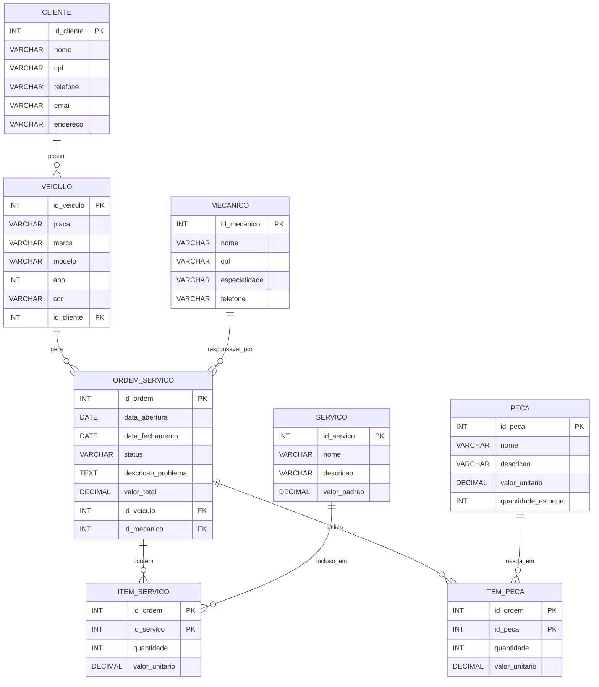

# Modelagem de Banco de Dados - Oficina Mecânica

Entregável Semana 02 - Disciplina: Modelagem de Banco de Dados

Este repositório tem a modelagem conceitual e o script SQL (DDL) de um banco de dados para uma oficina mecânica. O modelo foi feito usando os conceitos de MER (entidades, atributos, chaves e relacionamentos) e depois traduzido para SQL com CREATE TABLE.

---

## Cenário escolhido

A ideia é uma oficina mecânica que faz manutenção e reparo de veículos. O cliente chega com o carro, a oficina abre uma ordem de serviço, um mecânico fica responsável por ela, e nessa ordem podem ter vários serviços feitos e várias peças usadas. O sistema precisa guardar tudo isso: quem é o cliente, qual o carro, quem é o mecânico, o que foi feito e quais peças foram usadas.

Escolhi esse cenário porque os relacionamentos ficam bem claros e dá pra explorar tanto 1:N quanto N:N.

---

## Como identifiquei entidades e relacionamentos

Usando a técnica das duas leituras (procurar substantivos = entidades, verbos = relacionamentos):

"Um **cliente** possui um ou mais **veículos**. O cliente leva o veículo à oficina, que gera uma **ordem de serviço**. A ordem é atribuída a um **mecânico**. Cada ordem pode conter vários **serviços** e usar várias **peças**."

- Entidades: Cliente, Veículo, Mecânico, Ordem de Serviço, Serviço, Peça
- Relacionamentos: Possui, Gera, Atribuída, Contém, Utiliza

---

## Entidades e atributos

### Entidades fortes

**1. Cliente**
- id_cliente (INT) - PK
- nome (VARCHAR 100) - NOT NULL
- cpf (VARCHAR 14) - NOT NULL, UNIQUE
- telefone (VARCHAR 20) - NOT NULL
- email (VARCHAR 100)
- endereco (VARCHAR 200)

**2. Veículo**
- id_veiculo (INT) - PK
- placa (VARCHAR 10) - NOT NULL, UNIQUE
- marca (VARCHAR 50) - NOT NULL
- modelo (VARCHAR 50) - NOT NULL
- ano (INT) - NOT NULL
- cor (VARCHAR 30)
- id_cliente (INT) - FK referenciando Cliente

**3. Mecânico**
- id_mecanico (INT) - PK
- nome (VARCHAR 100) - NOT NULL
- cpf (VARCHAR 14) - NOT NULL, UNIQUE
- especialidade (VARCHAR 100) - NOT NULL
- telefone (VARCHAR 20) - NOT NULL

**4. Ordem de Serviço**
- id_ordem (INT) - PK
- data_abertura (DATE) - NOT NULL
- data_fechamento (DATE)
- status (VARCHAR 20) - NOT NULL, DEFAULT 'Aberta'
- descricao_problema (TEXT) - NOT NULL
- valor_total (DECIMAL 10,2) - DEFAULT 0.00
- id_veiculo (INT) - FK referenciando Veículo
- id_mecanico (INT) - FK referenciando Mecânico

**5. Serviço**
- id_servico (INT) - PK
- nome (VARCHAR 100) - NOT NULL
- descricao (VARCHAR 255)
- valor_padrao (DECIMAL 10,2) - NOT NULL

**6. Peça**
- id_peca (INT) - PK
- nome (VARCHAR 100) - NOT NULL
- descricao (VARCHAR 255)
- valor_unitario (DECIMAL 10,2) - NOT NULL
- quantidade_estoque (INT) - NOT NULL, DEFAULT 0

### Entidades fracas (tabelas associativas)

**7. Item de Serviço** - liga Ordem de Serviço com Serviço (N:N)
- id_ordem (INT) - PK, FK para Ordem de Serviço
- id_servico (INT) - PK, FK para Serviço
- quantidade (INT) - NOT NULL, DEFAULT 1
- valor_unitario (DECIMAL 10,2) - NOT NULL

**8. Item de Peça** - liga Ordem de Serviço com Peça (N:N)
- id_ordem (INT) - PK, FK para Ordem de Serviço
- id_peca (INT) - PK, FK para Peça
- quantidade (INT) - NOT NULL
- valor_unitario (DECIMAL 10,2) - NOT NULL

---

## Relacionamentos e cardinalidade

| De | Para | Cardinalidade | Explicação |
|---|---|---|---|
| Cliente | Veículo | 1:N | Um cliente pode ter vários veículos, mas cada veículo pertence a um só cliente |
| Veículo | Ordem de Serviço | 1:N | Um veículo pode ter várias ordens ao longo do tempo, cada ordem é de um veículo |
| Mecânico | Ordem de Serviço | 1:N | Um mecânico pode ser responsável por várias ordens, cada ordem tem um mecânico |
| Ordem de Serviço | Serviço | N:N | Uma ordem pode ter vários serviços e um serviço aparece em várias ordens |
| Ordem de Serviço | Peça | N:N | Uma ordem pode usar várias peças e uma peça pode ser usada em várias ordens |

Os dois relacionamentos N:N viraram tabelas associativas no SQL (item_servico e item_peca), cada uma com chave primária composta pelas duas chaves estrangeiras.

---

## Diagrama ER (Crow's Foot)

O diagrama foi feito em Mermaid com notação Crow's Foot:



---

## Script SQL (DDL)

O arquivo `schema.sql` tem todos os CREATE TABLE. Foi feito para PostgreSQL.

O que tem no script:
- 6 tabelas de entidades fortes (cliente, veiculo, mecanico, ordem_servico, servico, peca)
- 2 tabelas associativas (item_servico, item_peca) com chave primária composta
- Tipos de dados corretos para cada campo (INT, VARCHAR, DATE, TEXT, DECIMAL, SERIAL)
- Restrições de PRIMARY KEY, FOREIGN KEY, NOT NULL, UNIQUE e DEFAULT

Para rodar:

```
psql -U seu_usuario -d seu_banco -f schema.sql
```

---

## Arquivos do repositório

- `README.md` - esta documentação
- `schema.sql` - script DDL com os CREATE TABLE
